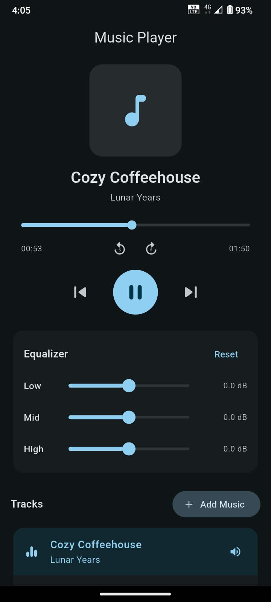

# Music Player with 3-Band Equalizer

An Android music player built with Flutter for the **Bose Professional Software Development Intern – Frontend Applications** practical challenge.

## Overview
A simple Android music player built using Flutter. It allows users to play bundled music or select audio files from their device. The application includes standard playback controls, a 3-band equalizer for adjusting **Low**, **Mid**, and **High** frequencies, and Android notification controls for managing playback in the background.

## Download

Download the latest Android APK from GitHub Releases:

[**Download Music Player v1.0.0 (APK)**](https://github.com/Sachin-Ananthakrishna/music_player/releases/tag/v1.0.0)


## Features

- **Music Playback**: Play three bundled audio tracks offline or add music files from your Android device.
- **Playback Controls**: Play, Pause, Previous track (restarts current track if `> 3s` elapsed, otherwise goes to previous) and Next track with automatically move to the next track when a song finishes.
- **Seek Controls**: Move through a track using the progress slider or dedicated 5-second rewind and forward buttons.
- **Real-Time 3-Band Equalizer**: Adjusts **Low**, **Mid**, and **High** gain in dB while music is playing, plus a **Reset** button to return all three bands to default (flat).
- **Background Playback**: Displays current track title, artist label, play/pause, previous and next controls in the Android notifications and lock screen.

## Screenshots

<div align="center">
  
</div>

## Tech Stack & Packages

Verified from `pubspec.yaml`, `pubspec.lock`, and `flutter --version`:

- **Flutter**: `3.44.8` (`stable`)
- **Dart**: `3.12.2` (SDK constraint `^3.12.2`)
- **Target Platform**: Android
- **Packages**:
  - `just_audio: ^0.10.6` (resolved `0.10.6`) — Audio playback, playlist management, and `AndroidEqualizer`
  - `just_audio_background: ^0.0.1-beta.17` (resolved `0.0.1-beta.17`, using `audio_service: 0.18.19`) — Android media notification and lock-screen controls
  - `file_picker: ^13.4.1` (resolved `13.4.1`) — System file picker for selecting device audio files
  - `cupertino_icons: ^1.0.8` (resolved `1.0.9`)
  - `flutter_lints: ^6.0.0` (dev dependency)

## Project Architecture

- [`lib/main.dart`](lib/main.dart) (`MusicPlayerApp`): Locks portrait orientation, initializes `JustAudioBackground`, configures the Material 3 dark theme, and sets `PlayerScreen` as home.
- [`lib/models/track.dart`](lib/models/track.dart) (`Track`): Immutable model with `title`, `artist`, `path`, and `isAsset`.
- [`lib/services/audio_player_service.dart`](lib/services/audio_player_service.dart) (`AudioPlayerService`): Handles audio playback, playlist management, seeking, equalizer settings and playback state updates using a single audio player instance.
- [`lib/screens/player_screen.dart`](lib/screens/player_screen.dart) (`PlayerScreen`): Owns and disposes `AudioPlayerService`, triggers `FilePicker.pickFile(type: FileType.audio)`, and composes the player UI.
- [`lib/widgets/progress_slider.dart`](lib/widgets/progress_slider.dart) (`ProgressSlider`): Seek slider with `mm:ss` elapsed/duration labels and 5-second rewind/forward buttons.
- [`lib/widgets/playback_controls.dart`](lib/widgets/playback_controls.dart) (`PlaybackControls`): Previous, prominent circular Play/Pause, and Next buttons.
- [`lib/widgets/equalizer_controls.dart`](lib/widgets/equalizer_controls.dart) (`EqualizerControls`): `Equalizer` card with `Low`, `Mid`, `High` sliders, dB readouts, and `Reset` button.

## Audio Playback & Controls

- **Bundled Playback**: The three bundled tracks are registered under `assets/audio/` in `pubspec.yaml` and loaded as a `just_audio` playlist via `setAudioSources(...)` with `AudioSource.asset(...)`.
- **User-Selected Playback**: `FilePicker.pickFile(type: FileType.audio)` opens the Android system picker without requesting broad storage permissions. Selected files are validated, appended to the playlist via `addAudioSource(AudioSource.file(...))`, and played immediately. Cancellation is ignored cleanly, and invalid/unplayable files are rolled back with a `SnackBar` message.
- **5-Second Seek**: `seekBy(Duration)` adds `-5s` or `+5s` to the current position, clamps between `Duration.zero` and `duration`, and delegates to `seekTo(...)`.

## Equalizer Implementation

- **Native Android EQ API**: Uses `just_audio`'s `AndroidEqualizer` (backed by `android.media.audiofx.Equalizer`). No custom DSP algorithm is implemented.
- **Attachment**: `AndroidEqualizer` is passed into `AudioPipeline(androidAudioEffects: [_equalizer])` on the single `AudioPlayer` instance.
- **Band Mapping**: After enabling the equalizer, `AudioPlayerService` awaits `AndroidEqualizer.parameters` to read the device's band count and `centerFrequency` (in Hz), mapping **Low**, **Mid**, and **High** to the bands closest to `250 Hz`, `1000 Hz`, and `4000 Hz`.
- **Gain & Reset**: Uses the device-reported `minDecibels..maxDecibels` range in dB. Slider changes call `band.setGain(gainDb)` in real time without restarting playback; **Reset** sets all three mapped bands to `0.0 dB` and notifies the UI.

## Android Notification Controls & Configuration

- Integrated `just_audio_background` to provide Android media notifications and lock-screen playback controls.
- Initialized `JustAudioBackground` before `runApp()` and attached `MediaItem` metadata to audio tracks to display track information.
- Configured Android's `AudioServiceActivity` and the required manifest permissions for background media playback and notification support.
- Implemented Play/Pause, Previous and Next controls, allowing users to manage music playback without opening the application.


## Challenges Faced

### 1. Background Audio Playback
Configuring background playback and Android media notifications required integrating `just_audio_background`, setting up the required Android components, and ensuring playback controls were accessible from the notification panel and lock screen.

### 2. Native Equalizer Integration
Implementing the 3-band equalizer required understanding how Android's native audio effects work with Flutter. I used `AndroidEqualizer` and mapped the Low, Mid, and High controls to the closest available frequency bands supported by the device.


## Installation & Running

1. **Install dependencies**:
   ```powershell
   flutter pub get
   ```
2. **Run the application**:
   ```powershell
   flutter run
   ```

## AI Tools Disclosure

- **ChatGPT** was used for planning.
- **Antigravity coding assistance** was used for coding assistance and documentation.

## Known Limitations

- **Android-only Equalizer**: Native equalizer functionality depends on Android audio effects.
- **Static Bundled Metadata**: Device tracks use the filename and `Device Audio` rather than parsing ID3 tags.
- **Session-Only Added Tracks**: User-selected tracks are kept in memory only for the current app session.
- **3-Band Mapping**: `Low`, `Mid` and `High` represent selected frequency bands from the device's native equalizer.

## Audio Assets Attribution

Credits from the original project setup for the bundled audio files:
- `bensound.com` (License code: `AOENVH17UKINZJM7`, Artist: Lunar Years)
- Sub_Clair from Pixabay
- ikoliks from Pixabay
